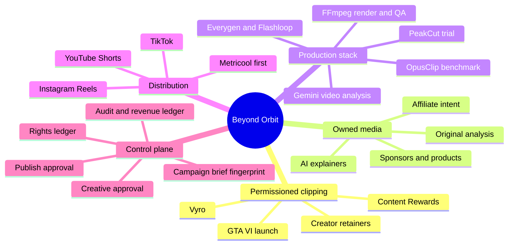

# Beyond Orbit — Company Operating Map and Build Plan

**Decision date:** November 17, 2026  
**Launch catalyst:** GTA VI releases at midnight local time on November 19, 2026.  
**Mission:** Build a family-owned, AI-assisted digital media company that earns from permissioned clipping, creator services, and original short-form media—without becoming a low-value repost farm.

## Executive decision

Beyond Orbit will run **two separate launch businesses** and two later experiments:

| Track | Product | Revenue route | Channel strategy | Tonight |
|---|---|---|---|---|
| A — Campaign clipping | Brief-compliant clips from footage explicitly named or supplied by Content Rewards/Vyro campaigns | Campaign CPM/pools | Dedicated campaign/GTA account | Launch priority |
| B — Creator service | Clips made under written permission for streamers, podcasters, and businesses | Monthly retainer + performance bonus | Prefer creator-owned accounts | Prepare pilot offer |
| C — Owned explainers | Original research, script, narration, and licensed/AI visuals | YouTube/TikTok platform revenue, affiliates, sponsors, products | Separate `Beyond Orbit Explains` identity | Build first original test |
| D — Kids animation | Original children’s animation and educational stories | YouTube/brand/licensing later | Separate made-for-kids channel | Hold; compliance pilot later |

This separation is deliberate. Campaign clipping may pay quickly but minimally edited reused footage can weaken channel-level monetization. Owned explainers are slower but create durable intellectual property and a cleaner platform-monetization case.

## What is already real

- The NASA Apollo 15 Short is the visual benchmark. It proved the earlier engine can cut real footage, preserve audio, caption, render vertically, pass mechanical QA, and wait for approval.
- The remote `rahul3sr/BeyondOrbit` repository contains working FFmpeg production, campaign schemas, a loopback review UI, exact-version approval logic, tests, and mock-only social adapters across several branches.
- Tonight’s local build adds a **fail-closed Master Clipper control plane** that blocks editing when rights evidence is missing and requires exact-version creative and publish approvals.

What is **not** real yet: live social OAuth, live posting, verified account handles, stored API keys, joined campaigns, a production PeakCut installation, recurring analytics ingestion, or earned revenue.

## Company mind map

## The five systems—not one “AI clipping tool”

1. **Opportunity system:** discovers Content Rewards/Vyro campaigns and creator prospects; records economics, eligibility, deadlines, and evidence.
2. **Rights system:** rejects unknown ownership, leaked footage, random TV/Netflix files, unclear music, and expired permissions.
3. **Production system:** finds candidate moments, transcribes, crops, captions, adds original narrative, and renders variants.
4. **Distribution system:** stages platform-specific files and metadata, obtains exact-file approval, then schedules/publishes.
5. **Learning and finance system:** imports results at 2h/24h/7d, attributes campaign/platform/client revenue, and improves decisions.

No production tool is allowed to bypass the rights, approval, or finance systems.

## Tool decisions

| Tool | Actual role | Decision | Important limit |
|---|---|---|---|
| Existing Beyond Orbit FFmpeg code | Rendering, captions, QA, manifests, approvals | Preserve and consolidate | Social publishing is still mock-only |
| PeakCut | Open-source self-hosted clipping, transcription, titles, live buffers, social queue | Trial in an isolated local folder after audit | Created Nov. 14, 2026; too new to be the sole production foundation |
| Gemini API | Analyze public YouTube URLs or uploaded video; return candidate timestamps and structured notes | Primary low-cost video-understanding experiment | Preview limits can change; Google access is not copyright permission |
| OpenAI API | Reasoning, structured briefs, metadata, QA, agent orchestration | Optional secondary provider | Do not duplicate the same task across three paid APIs by default |
| Claude API | Prompt/brief analysis and an alternative reasoning provider | Optional benchmark/fallback | Claude consumer subscription and API billing are separate |
| OpusClip connector | Managed clipping benchmark and fallback | Connect after OAuth approval; A/B test against PeakCut | Vendor credits and data terms apply; not open source |
| Everygen Wizard/MCP | Generate original explainers, ads, animation, voice, captions | Core Track C candidate | Reference style is inspiration, not permission to copy ideas/assets |
| Flashloop MCP | Generate original clips/images/characters/voiceovers | Track C/D alternative | Uses plan credits; OAuth connection is persistent access |
| Higgsfield | Original intros/transitions or creative generation | Optional experiment | Earlier repository integration is only a mock |
| Metricool | Initial cross-platform scheduler and analytics | Use after accounts exist | It does not grant content rights or guarantee every native feature |
| Content Rewards / Vyro | Campaign marketplaces | Use for Track A | Campaign approval and budget—not posting alone—determine earnings |

### PeakCut audit conclusion

PeakCut is a genuine MIT-licensed project with Python, FFmpeg, `yt-dlp`, local speech-to-text, multiple AI providers, account workspaces, posting queues, and tests. It reads its AI credential from an ignored data store or environment configuration. It does **not** mean a key should be pasted into source code. The repository was created only four days before this decision and had roughly 14 commits when reviewed, so it remains an isolated trial dependency until pinned, scanned, and tested.

PeakCut’s current design sends a local transcript and selected context to the configured chat model. Gemini separately supports direct public-YouTube-URL analysis, but that is a distinct Google API capability and should be benchmarked explicitly rather than assumed to be PeakCut’s behavior.

## Channel and brand architecture

Do not mix every revenue model into one feed.

| Identity | Purpose | Monetization expectation |
|---|---|---|
| `Beyond Orbit` | Parent company and portfolio | Corporate proof, not a high-volume feed |
| `Beyond Orbit GTA` | GTA campaign and permissioned creator clips | Content Rewards/Vyro/client fees first; platform revenue is upside, not assumed |
| `Beyond Orbit Explains` | Original 60–180 second explainers and analysis | Primary YouTube/TikTok/affiliate/sponsor asset |
| Future kids identity | Original child-directed animation | Separate compliance, audience, metadata, and economics |

If a campaign requires a GTA-only handle, use the GTA identity. Do not contaminate the original-content channel with low-transform campaign inventory merely to reuse an audience.

## Master Clipper Agent

The Master Clipper Agent is an orchestrator, not a single model. It has seven roles:

1. **Opportunity Analyst:** compare campaigns and creator prospects by expected contribution, not headline views.
2. **Rights Officer:** require owner, commercial-use grant, scope, platforms, expiry, music status, and evidence URL.
3. **Brief Compiler:** turn the joined campaign brief into machine-readable rules and fingerprint it.
4. **Clip Producer:** send authorized jobs to PeakCut/FFmpeg/OpusClip and produce candidates.
5. **Originality Editor:** add thesis, narration, explanation, and material transformation when the channel requires platform monetization.
6. **QA and Policy Reviewer:** check captions, crop, audio, spoilers, disclosures, brand safety, and current platform rules.
7. **Publisher/Analyst:** stage exact files, wait for approval, publish through an approved adapter, then import results and cash evidence.

The agent learns from tutorials through a claim ledger. A tactic is usable only when marked `VERIFIED`; product marketing, earnings claims, and “viral” predictions remain `UNVERIFIED` until evidence supports them.

## Approval architecture

Master’s desired operating model is encoded as four business approvals and two technical hashes:

| Gate | What Master approves | System consequence |
|---|---|---|
| 1. Campaign join | Exact campaign, current economics, rights, requirements, and account implications | Agent may join/accept terms |
| 2. Account/OAuth | Exact service, account, scopes, and persistence | Agent may connect that account |
| 3. Creative | Exact video bytes plus title/caption/description | File becomes eligible for final staging |
| 4. Publish | Exact creative digest, destinations, privacy, disclosure, timing, and campaign fingerprint | Live adapter may publish once |

Any change to the video, metadata, destinations, or campaign terms invalidates the relevant approval. Local approval records are audit evidence; they are not a substitute for authenticated identity in a hosted production system.

## Rights rule

Every source must enter a ledger with:

- source owner, URL, and file hash;
- rights basis: `campaign_license`, `written_creator_permission`, `owned`, or `licensed`;
- commercial use allowed;
- exact platforms/accounts;
- editing, attribution, disclosure, music, spoiler, and takedown terms;
- start/expiry date and verification timestamp;
- evidence URL or retained agreement; and
- campaign brief fingerprint when applicable.

**Fail closed:** “It is on YouTube,” “a streamer is popular,” “it is in Google Drive,” “the campaign mentions the show,” or “others are posting it” are not licenses.

Netflix/TV/podcast full episodes may be used only when the campaign owner explicitly supplies or names the material and grants commercial redistribution/derivative rights for the relevant platforms. Otherwise the job is rejected before download.

## Content formats

### Track A — reach clips (15–45 seconds)

- use only named/supplied campaign or permissioned creator sources;
- hook in the first second, one context, one payoff;
- remove third-party music unless the brief licenses it;
- no leaks, cheats, isolated cinematics, or major spoilers;
- optimize for campaign approval and service value, not assumed YPP revenue.

### Track B/C — monetizable original analysis (60–180 seconds)

- original thesis and narration;
- explain why the moment matters or compare choices/mechanics;
- use only the minimum permissioned third-party footage needed;
- visibly demonstrate research, analysis, or an original story;
- maintain source notes and factual checks.

### Original AI explainer

- start with a researched idea, not a copied video premise;
- create a new outline, examples, script, narration, visuals, and edit;
- reference videos may be analyzed for pacing/structure, never downloaded or cloned scene-by-scene;
- license or own music, voices, images, characters, and logos;
- disclose synthetic media when required.

## Monetization map

| Route | Speed | Durability | Economics to track | Decision |
|---|---:|---:|---|---|
| Content Rewards/Vyro | Fast | Low–medium | eligible views × CPM, cap, budget, rejection, fees | Launch wedge |
| Creator retainer | Medium | High | fixed fee + bonus − delivery cost | Primary recurring target |
| YouTube Shorts/YPP | Slow | Medium | eligibility, engaged views, RPM, reused-content risk | Owned channel only as base case |
| TikTok Creator Rewards | Slow | Medium | original 1+ minute qualified videos, eligibility, RPM | Owned analysis/explainers |
| Instagram compensation | Unpredictable | Low | only live in-account programs/brand deals | Do not model as guaranteed |
| Affiliate/sponsors/products | Medium–slow | High | clicks, conversion, margin, disclosure | Add after audience intent is proven |

The best current tutorial’s three-level model is directionally correct: campaigns build skill/proof, creator retainers create recurring revenue, and strategy/original production moves closer to business outcomes. Its specific claims of $10K–$100K monthly income are marketing ranges, not a forecast for Beyond Orbit.

## Campaign snapshot

TOMO, RUCKUS, LACY, Clix, and Tokyo Girl were discovered as GTA VI leads on November 17. Their public cards are not sufficient proof that they remain open or that a new account qualifies. Joined pages and current briefs are authoritative.

Before approving any join, capture:

- active/open status, remaining budget, rate or pool, minimum and cap;
- exact approved source/VOD and usage grant;
- account age/follower/theme/country requirements;
- platforms, length, caption, music, hashtag, disclosure, and bio rules;
- opening, deadline, submission timing, and review/takedown rules;
- payment method, verification method, fees, and cash timing.

## Secure API and OAuth architecture

### Keys

- Create separate development projects for OpenAI, Anthropic, and Google only when a benchmark requires them.
- Start with Gemini for PeakCut/video understanding; do not pay three providers for identical highlight selection.
- Use environment variables `GEMINI_API_KEY`, `OPENAI_API_KEY`, and `ANTHROPIC_API_KEY` in an ignored `.env` or managed secret store.
- Never paste a key into source, GitHub, chat, screenshots, browser JavaScript, issue text, or logs.
- Use separate development and production credentials, restrictive quotas, alerts, rotation, and documented owner.
- PeakCut may use `PEAKCUT_AI_KEY` in its ignored local configuration; the value must never be committed.

### OAuth/connectors

- Prefer official OAuth for YouTube, Instagram, TikTok, Metricool, OpusClip, Everygen, and Flashloop.
- Record service, account, scopes, date, owner, renewal/expiry, and revocation URL.
- Never store social passwords in this project.
- Persistent OAuth connections require Master’s approval at the authorization screen.

## Tonight’s build order

### Completed in this workspace

1. Consolidated the operating architecture into separate campaign, creator-service, original-explainer, and kids tracks.
2. Added `beyond_orbit/control_plane.py` with fail-closed rights checks.
3. Added two exact-version gates: creative approval and publish approval.
4. Added safe/unsafe intake examples and tests that prove post-approval changes invalidate release.
5. Added an API-secret template with live publishing disabled.
6. Reviewed the strongest tutorial transcript and separated valid strategy from unverified income/product claims.

### Next tonight—requires live account decisions

1. Inspect and rank current Content Rewards and Vyro campaigns after login.
2. Approve only the best one or two campaigns; avoid spreading a new account across five briefs.
3. Reserve the GTA campaign handle on YouTube/Instagram/TikTok; create the owned-explainer handle separately.
4. Enable 2FA and record recovery ownership.
5. Connect accounts to Metricool with the minimum scopes.
6. Create one Gemini development key with a small quota; test PeakCut locally with owned/NASA footage.
7. Connect OpusClip only for an A/B benchmark; do not pay for both tools until output quality is measured.
8. Connect Everygen for one original 60–90 second explainer pilot.
9. Produce three exact platform variants, approve creative, then approve a private/unlisted test publication.
10. Do not publish GTA gameplay until release, rights, brief, audio, disclosure, and exact-file gates all pass.

## Seven-day operating plan

| Day | Outcome |
|---|---|
| 0 | Accounts, campaign brief, secret setup, private original test |
| 1 | GTA launch intake, 10 candidates, approve 3–5 campaign clips |
| 2 | Publish measured batch; create first original GTA analysis video |
| 3 | Review 2h/24h performance and rejection data; adjust hooks |
| 4 | Outreach to 10 qualified creators with one permission-safe sample offer |
| 5 | Test PeakCut vs OpusClip output/time/cost on the same owned source |
| 6 | Second campaign batch plus second owned explainer |
| 7 | CFO review: revenue, cash, costs, approval rate, retention, follower quality, decision to scale/stop |

## 30/90-day roadmap

### First 30 days

- reach first verified campaign cash receipt;
- publish 20–40 permissioned clips and 8–12 original explainers;
- sign one creator pilot or reject the service model with evidence;
- measure contribution by clip and by production engine;
- consolidate the remote repository into one private canonical branch;
- keep live publishing behind one-time exact-version approval.

### By 90 days

- choose the winning business: campaign cash, creator retainers, or owned media;
- target at least 50% recurring/owned revenue before adding headcount;
- automate only tasks with stable error rates and positive contribution;
- add affiliates/sponsors/products only where audience intent is demonstrated;
- decide whether kids animation deserves a separate compliance-tested pilot.

## CFO dashboard

Track forecast, accrued revenue, and received cash separately.

| Area | KPI |
|---|---|
| Rights | % jobs with complete evidence; takedowns/claims/strikes |
| Production | minutes/job, cost/job, render failure, human rework |
| Campaign | submission approval, eligible views, effective CPM, cap/budget loss |
| Audience | hook hold, completion, shares, follower conversion, 7-day return |
| Platform | YPP/TikTok eligibility progress; reused-content flags |
| Finance | gross, cash collected, software/API cost, labor proxy, contribution per clip |
| Sales | prospects, replies, samples, pilots, MRR, churn |

### Kill/scale rules

- Stop a campaign after three compliant rejections or negative expected contribution unless a specific correctable cause exists.
- Stop a tool if it does not beat the current baseline on two of quality, time, or cost.
- Do not add paid automation before the manual workflow produces at least one verified payout or client commitment.
- Scale a format only after at least five posts show repeatable retention—not one viral outlier.

## Launch gate

No content publishes unless all are true:

- source owner and commercial permission are documented;
- campaign/source/brief is current and fingerprinted when applicable;
- GTA VI is officially released in the relevant territory for gameplay content;
- music, third-party assets, spoilers, disclosures, and platform rules pass;
- channel choice matches the revenue model;
- video and metadata pass creative QA;
- Master approves the exact creative digest;
- Master approves the exact destinations and publish digest;
- revenue hypothesis and tracking ID exist.

## Primary references

- Rockstar GTA VI release: https://support.rockstargames.com/articles/29jV3Cv2cCgvwM1XgtMO5o/grand-theft-auto-vi-regional-pre-load-and-release-times-on-playstation-5-and-xbox-series-x-or-s
- Rockstar copyrighted-material policy: https://support.rockstargames.com/articles/7bNaeoMFTV0iUDGhStTXvz/policy-on-posting-copyrighted-rockstar-games-material
- YouTube monetization/reused content: https://support.google.com/youtube/answer/1311392
- TikTok Creator Rewards: https://support.tiktok.com/en/business-and-creator/creator-rewards-program/how-is-the-creator-rewards-program-different-from-the-tiktok-creator-fund
- Gemini video understanding: https://ai.google.dev/gemini-api/docs/video-understanding
- Gemini API keys: https://ai.google.dev/gemini-api/docs/api-key
- PeakCut: https://github.com/haziqahmedqasmi/PeakCut
- OpusClip MCP: https://www.opus.pro/mcp
- Everygen official site/MCP: https://everygen.ai/ and https://everygen.ai/mcp
- Flashloop MCP: https://www.flashloop.ai/mcp
- Vyro creators/terms: https://vyro.com/creators and https://vyro.com/creator-terms
- Existing Beyond Orbit repository: https://github.com/rahul3sr/BeyondOrbit
