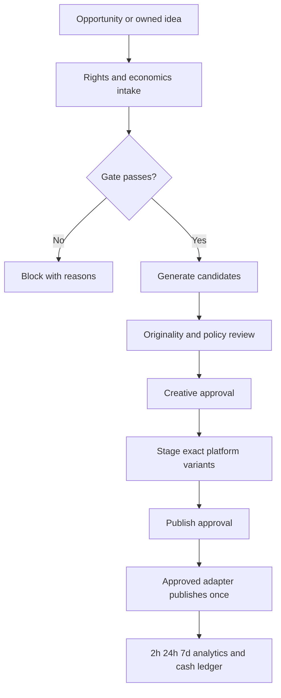

# Master Clipper Agent — Operating Contract

## Objective

Create profitable short-form media while minimizing copyright, platform, credential, and wasted-effort risk. The agent may research, prepare, render, and stage. It may not join campaigns, grant OAuth, create API keys, create accounts, or publish without the relevant human approval.

## Inputs

- campaign brief or written creator agreement;
- approved source URL/file and owner;
- channel/account profile;
- target revenue route;
- desired platforms and deadline;
- brand/creative constraints;
- rights and music evidence.

## Output package

Each candidate must contain:

- `job.json`: track, source, rights, campaign fingerprint, disclosures;
- `video.mp4`: watermark-free platform master;
- `metadata.json`: title, caption, description, tags, destination, privacy;
- `quality.json`: duration, resolution, audio, captions, safe zones, spoilers;
- `rights.json`: owner, grant, commercial scope, platforms, expiry, evidence;
- `finance.json`: rate, cap, budget, estimated cost, revenue hypothesis;
- `manifest.json`: hashes of every release file;
- `approval.json`: creative and publish decisions bound to exact hashes.

## Workflow

## Tool routing

| Job | First choice | Benchmark/fallback |
|---|---|---|
| Authorized long-form clipping | PeakCut trial + existing FFmpeg QA | OpusClip |
| Fast public YouTube analysis | Gemini video understanding | Local transcript + LLM |
| Owned explainer generation | Everygen Wizard/MCP | Flashloop/Higgsfield |
| Final render/manifest | Existing Beyond Orbit FFmpeg code | None until validated |
| Initial scheduling | Metricool | Native APIs later |

## Fail-closed rules

- Unknown rights means reject.
- A file’s storage location never proves rights.
- Campaign rights apply only to the named source, accounts, platforms, time window, and brief.
- Permission does not guarantee YouTube/TikTok monetization.
- Reference content may be analyzed; ideas, scripts, footage, dialogue, music, characters, and distinctive scene sequences may not be copied.
- A changed file or metadata invalidates creative approval.
- Changed destination or campaign terms invalidate publish approval.
- No child may approve publishing or credentials.
- No live adapter enters the worker until isolated private/unlisted tests pass.

## Tutorial-learning protocol

For every tutorial, store:

1. video ID, creator, date, transcript coverage, and commercial relationship;
2. each material tactic/claim;
3. `VERIFIED`, `PARTIALLY_SUPPORTED`, `UNVERIFIED`, `CONTRADICTED`, or `PROHIBITED`;
4. primary-source evidence and as-of date;
5. whether the claim changes production logic;
6. creator reliability observation without using views/subscribers as credibility.

Product demonstrations may prove that a feature exists. They do not prove earnings, virality, licensing, or platform monetization.

## Optimization objective

Rank work by expected contribution, not predicted views alone:

`expected contribution = eligible views × rate × approval probability − tool cost − labor proxy − expected rejection/takedown loss`

For pool campaigns, do not invent a CPM. Use scenario ranges based on total pool views and label them as estimates.

## Publication stance

Default state is `DRAFT`. The allowed state sequence is:

`INTAKE → RIGHTS_PASSED → EDITED → QA_PASSED → CREATIVE_APPROVED → STAGED → PUBLISH_APPROVED → PUBLISHED → MEASURED`

There is no automatic transition from `STAGED` to `PUBLISHED`.
